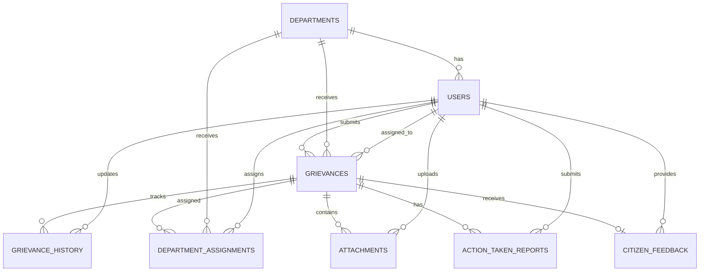

# Database Design

## 1. Introduction

The CM Kerala – Chief Minister's Public Grievance Redressal Portal uses PostgreSQL as its relational database management system.

The database is designed to manage citizen accounts, government departments, grievances, department assignments, grievance status history, supporting attachments, action-taken reports, citizen feedback and contact enquiries.

The database follows a relational structure with primary keys, foreign keys, constraints and indexes to maintain data integrity and support efficient retrieval.

### Database Information

| Property | Details |
|---|---|
| Database Name | `cm_grievance` |
| Database | PostgreSQL |
| Backend | Node.js + Express.js |
| Frontend | React.js |
| Database Driver | node-postgres (`pg`) |
| Primary Key | UUID |
| Architecture | Relational Database |

---

## 2. Database Entities

The database consists of the following nine main tables:

| No. | Table Name | Description |
|---|---|---|
| 1 | `users` | Stores citizens, CMO administrators and department officers |
| 2 | `departments` | Stores government department information |
| 3 | `grievances` | Stores grievances submitted by citizens |
| 4 | `grievance_history` | Maintains grievance status change history |
| 5 | `department_assignments` | Records department forwarding and officer assignments |
| 6 | `attachments` | Stores supporting document and image metadata |
| 7 | `action_taken_reports` | Stores investigation and resolution reports |
| 8 | `citizen_feedback` | Stores citizen feedback after grievance resolution |
| 9 | `contact_enquiries` | Stores enquiries submitted through the public contact form |

---

## 3. Table Structures

### 3.1 Users

**Table Name:** `users`

Stores user information for all three application roles.

| Column | Data Type | Constraint | Description |
|---|---|---|---|
| id | UUID | Primary Key | Unique user identifier |
| name | VARCHAR(150) | NOT NULL | User's full name |
| email | VARCHAR(150) | UNIQUE, NOT NULL | Email address |
| mobile | VARCHAR(15) | UNIQUE | Mobile number |
| password_hash | TEXT | NOT NULL | Hashed password |
| role | VARCHAR(30) | NOT NULL | User role |
| department_id | UUID | Foreign Key | Associated department |
| is_active | BOOLEAN | DEFAULT TRUE | Account status |
| created_at | TIMESTAMP | DEFAULT CURRENT_TIMESTAMP | Account creation time |
| updated_at | TIMESTAMP | DEFAULT CURRENT_TIMESTAMP | Last update time |

**Supported roles:**
- `citizen`
- `cmo_admin`
- `department_officer`

Department officers are associated with a department through `department_id`.

### 3.2 Departments

**Table Name:** `departments`

Stores government department information.

| Column | Data Type | Constraint | Description |
|---|---|---|---|
| id | UUID | Primary Key | Department identifier |
| name | VARCHAR(150) | UNIQUE, NOT NULL | Department name |
| description | TEXT | - | Department description |
| contact_email | VARCHAR(150) | - | Contact email |
| contact_phone | VARCHAR(20) | - | Contact number |
| is_active | BOOLEAN | DEFAULT TRUE | Department status |
| created_at | TIMESTAMP | DEFAULT CURRENT_TIMESTAMP | Creation time |

### 3.3 Grievances

**Table Name:** `grievances`

Stores complaints submitted by registered citizens.

| Column | Data Type | Constraint | Description |
|---|---|---|---|
| id | UUID | Primary Key | Grievance identifier |
| reference_number | VARCHAR(30) | UNIQUE, NOT NULL | Unique tracking number |
| citizen_id | UUID | Foreign Key, NOT NULL | Submitting citizen |
| district | VARCHAR(100) | NOT NULL | Kerala district |
| category | VARCHAR(100) | NOT NULL | Grievance category |
| subject | VARCHAR(255) | NOT NULL | Complaint subject |
| description | TEXT | NOT NULL | Detailed complaint |
| priority | VARCHAR(20) | DEFAULT Medium | Low, Medium or High |
| status | VARCHAR(30) | DEFAULT Submitted | Current grievance status |
| current_department_id | UUID | Foreign Key | Currently assigned department |
| assigned_officer_id | UUID | Foreign Key | Currently assigned officer |
| ai_summary | TEXT | - | AI-generated summary |
| ai_suggested_department | VARCHAR(150) | - | AI department recommendation |
| ai_suggested_category | VARCHAR(100) | - | AI category recommendation |
| ai_suggested_priority | VARCHAR(20) | - | AI priority recommendation |
| created_at | TIMESTAMP | DEFAULT CURRENT_TIMESTAMP | Submission time |
| updated_at | TIMESTAMP | DEFAULT CURRENT_TIMESTAMP | Last update time |
| resolved_at | TIMESTAMP | - | Resolution time |

**Supported grievance statuses:**
1. Submitted
2. Under Review
3. In Progress
4. Resolved
5. Reopened

AI-generated values are recommendations and do not automatically determine official grievance decisions.

### 3.4 Grievance History

**Table Name:** `grievance_history`

Maintains a complete record of grievance status changes and administrative remarks.

| Column | Data Type | Constraint | Description |
|---|---|---|---|
| id | UUID | Primary Key | History identifier |
| grievance_id | UUID | Foreign Key, NOT NULL | Associated grievance |
| previous_status | VARCHAR(30) | - | Previous status |
| new_status | VARCHAR(30) | NOT NULL | Updated status |
| remarks | TEXT | - | Status update remarks |
| changed_by | UUID | Foreign Key, NOT NULL | User responsible for change |
| visibility | VARCHAR(20) | DEFAULT public | Public or internal remark |
| created_at | TIMESTAMP | DEFAULT CURRENT_TIMESTAMP | Change timestamp |

Every grievance status change is recorded with its timestamp and responsible user.

Internal administrative remarks are not displayed to citizens.

### 3.5 Department Assignments

**Table Name:** `department_assignments`

Maintains department forwarding and officer assignment records.

| Column | Data Type | Constraint | Description |
|---|---|---|---|
| id | UUID | Primary Key | Assignment identifier |
| grievance_id | UUID | Foreign Key, NOT NULL | Associated grievance |
| department_id | UUID | Foreign Key, NOT NULL | Assigned department |
| assigned_officer_id | UUID | Foreign Key | Assigned officer |
| assigned_by | UUID | Foreign Key, NOT NULL | CMO administrator |
| assignment_remarks | TEXT | - | Assignment instructions |
| assigned_at | TIMESTAMP | DEFAULT CURRENT_TIMESTAMP | Assignment time |
| is_current | BOOLEAN | DEFAULT TRUE | Current assignment indicator |

This table preserves the assignment history when grievances are forwarded between departments or officers.

### 3.6 Attachments

**Table Name:** `attachments`

Stores metadata and file references for supporting grievance documents.

| Column | Data Type | Constraint | Description |
|---|---|---|---|
| id | UUID | Primary Key | Attachment identifier |
| grievance_id | UUID | Foreign Key, NOT NULL | Associated grievance |
| uploaded_by | UUID | Foreign Key, NOT NULL | Uploading user |
| file_name | VARCHAR(255) | NOT NULL | Original file name |
| file_url | TEXT | NOT NULL | File storage location |
| file_type | VARCHAR(100) | - | MIME type |
| file_size | BIGINT | - | File size in bytes |
| uploaded_at | TIMESTAMP | DEFAULT CURRENT_TIMESTAMP | Upload timestamp |

The actual files are stored in file storage. PostgreSQL stores their metadata and retrieval references.

### 3.7 Action Taken Reports

**Table Name:** `action_taken_reports`

Stores investigation reports and resolution details submitted by department officers.

| Column | Data Type | Constraint | Description |
|---|---|---|---|
| id | UUID | Primary Key | Report identifier |
| grievance_id | UUID | Foreign Key, NOT NULL | Associated grievance |
| officer_id | UUID | Foreign Key, NOT NULL | Reporting officer |
| investigation_remarks | TEXT | NOT NULL | Investigation findings |
| action_taken | TEXT | NOT NULL | Actions performed |
| resolution_details | TEXT | - | Proposed resolution |
| submitted_at | TIMESTAMP | DEFAULT CURRENT_TIMESTAMP | Submission time |
| reviewed_by | UUID | Foreign Key | Reviewing CMO administrator |
| reviewed_at | TIMESTAMP | - | Review time |
| review_status | VARCHAR(30) | DEFAULT Pending | Review status |
| cmo_remarks | TEXT | - | CMO review remarks |

**Review statuses:**
- Pending
- Accepted
- Rejected

The CMO reviews department responses before accepting a resolution.

### 3.8 Citizen Feedback

**Table Name:** `citizen_feedback`

Stores feedback submitted by citizens after grievance resolution.

| Column | Data Type | Constraint | Description |
|---|---|---|---|
| id | UUID | Primary Key | Feedback identifier |
| grievance_id | UUID | Foreign Key, UNIQUE | Associated grievance |
| citizen_id | UUID | Foreign Key | Submitting citizen |
| rating | INTEGER | 1–5 | Citizen rating |
| feedback | TEXT | - | Feedback description |
| created_at | TIMESTAMP | DEFAULT CURRENT_TIMESTAMP | Submission time |

### 3.9 Contact Enquiries

**Table Name:** `contact_enquiries`

Stores messages submitted through the public Contact Us page.

| Column | Data Type | Constraint | Description |
|---|---|---|---|
| id | UUID | Primary Key | Enquiry identifier |
| name | VARCHAR(150) | NOT NULL | Sender name |
| email | VARCHAR(150) | NOT NULL | Sender email |
| subject | VARCHAR(255) | NOT NULL | Enquiry subject |
| message | TEXT | NOT NULL | Message content |
| status | VARCHAR(30) | DEFAULT New | Enquiry status |
| created_at | TIMESTAMP | DEFAULT CURRENT_TIMESTAMP | Submission time |

---

## 4. Entity Relationships

The database uses the following relationships:

| Parent Table | Child Table | Relationship |
|---|---|---|
| departments | users | One-to-Many |
| users | grievances | One-to-Many |
| departments | grievances | One-to-Many |
| users | grievances (assigned officer) | One-to-Many |
| grievances | grievance_history | One-to-Many |
| users | grievance_history | One-to-Many |
| grievances | department_assignments | One-to-Many |
| departments | department_assignments | One-to-Many |
| users | department_assignments | One-to-Many |
| grievances | attachments | One-to-Many |
| users | attachments | One-to-Many |
| grievances | action_taken_reports | One-to-Many |
| users | action_taken_reports | One-to-Many |
| grievances | citizen_feedback | One-to-One |
| users | citizen_feedback | One-to-Many |

The `contact_enquiries` table operates independently.

### Relationship Explanation

1. A department can have multiple department officers.
2. A citizen can submit multiple grievances.
3. A department can receive multiple grievances.
4. A grievance can have multiple status history records.
5. A grievance can be assigned multiple times, preserving assignment history.
6. A grievance can have multiple supporting attachments.
7. A grievance can have multiple action-taken reports.
8. A resolved grievance can receive citizen feedback.
9. Every status change is associated with the user responsible for the change.

---

## 5. Entity Relationship Diagram

The following diagram illustrates the main database relationships.



---

## 6. Database Constraints and Indexing

The database uses constraints to maintain consistency and prevent invalid data.

### Primary Keys
Every main entity uses a UUID primary key.

### Foreign Keys
Foreign keys maintain relationships between users, departments, grievances and their related records.

### Unique Constraints
- User email addresses must be unique.
- Mobile numbers must be unique when provided.
- Grievance reference numbers must be unique.
- Department names must be unique.
- A grievance can have only one citizen feedback record.

### Check Constraints
- User roles must belong to the three supported roles.
- Grievance priority must be Low, Medium or High.
- Grievance status must belong to the five supported statuses.
- Citizen feedback rating must be between 1 and 5.

### Indexing

Indexes are created on frequently searched and filtered columns.

Recommended indexes:

- `users.role`
- `users.department_id`
- `grievances.citizen_id`
- `grievances.status`
- `grievances.district`
- `grievances.current_department_id`
- `grievances.priority`
- `grievance_history.grievance_id`
- `department_assignments.grievance_id`

These indexes support citizen tracking, CMO dashboard filtering and department-level grievance retrieval.

---

## 7. Grievance Workflow and Database Operations

The database supports the complete grievance lifecycle.

### Step 1: Citizen Submission
- Citizen submits a grievance.
- A unique reference number is generated.
- A grievance record is inserted into `grievances`.
- Supporting files are recorded in `attachments`.
- Initial status is set to `Submitted`.
- An initial record is inserted into `grievance_history`.

### Step 2: CMO Review
- CMO administrator reviews the grievance.
- Status changes to `Under Review`.
- Administrative remarks are recorded in `grievance_history`.

### Step 3: Department Assignment
- CMO selects the appropriate department.
- An assignment record is created in `department_assignments`.
- The grievance's current department and assigned officer are updated.
- Status changes to `In Progress`.

### Step 4: Department Investigation
- Department officer views assigned grievances.
- Investigation details are submitted.
- An action-taken report is inserted into `action_taken_reports`.
- Relevant status changes are recorded in `grievance_history`.

### Step 5: CMO Review and Resolution
- CMO reviews the action-taken report.
- The report can be accepted or rejected.
- If accepted, the grievance can be marked `Resolved`.
- Resolution information and status history are persisted.

### Step 6: Citizen Feedback
- Citizen receives the resolution update.
- Citizen can provide a rating and feedback.
- Feedback is stored in `citizen_feedback`.

### Step 7: Reopening
- If a grievance needs further action, it can be reopened.
- Status changes to `Reopened`.
- The reopening event is recorded in `grievance_history`.

All status changes and related database operations should be handled through backend transactions to maintain data consistency.

---

## 8. Database Security

The following security measures are implemented or planned:

1. Passwords are stored using secure password hashing.
2. SQL queries use parameterized statements to prevent SQL injection.
3. Role-based authorization controls access to database operations.
4. Citizens can access only their own grievances.
5. Department officers can access grievances assigned to their department.
6. CMO administrators can access and manage all grievances.
7. Internal administrative remarks are restricted to authorized personnel.
8. Supporting file uploads are validated by type and size.
9. Database credentials are stored in environment variables.
10. Sensitive credentials are excluded from GitHub.

---

## 9. Database Configuration

The backend connects to PostgreSQL through the `pg` Node.js package.

Example environment configuration:

```env
DB_HOST=localhost
DB_PORT=5432
DB_NAME=cm_grievance
DB_USER=postgres
DB_PASSWORD=your_local_password
```

The actual database credentials must be configured in the local or deployment environment and must not be committed to the repository.

---

## 10. Conclusion

The PostgreSQL database design provides a structured foundation for the CM Kerala Grievance Redressal Portal.

It supports multi-role authentication, grievance submission, department assignment, investigation reports, status tracking, supporting documents, citizen feedback and administrative monitoring.

The relational design ensures data integrity through primary keys, foreign keys, unique constraints and indexes while maintaining a traceable history of grievance activities.

The schema is designed to support the citizen, CMO administrator and department officer workflows required by the WhiteMatrix Software Solutions recruitment assignment.